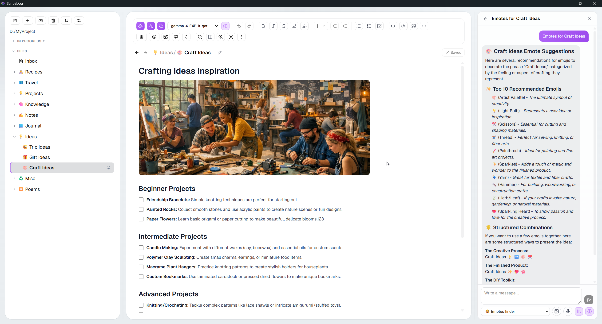
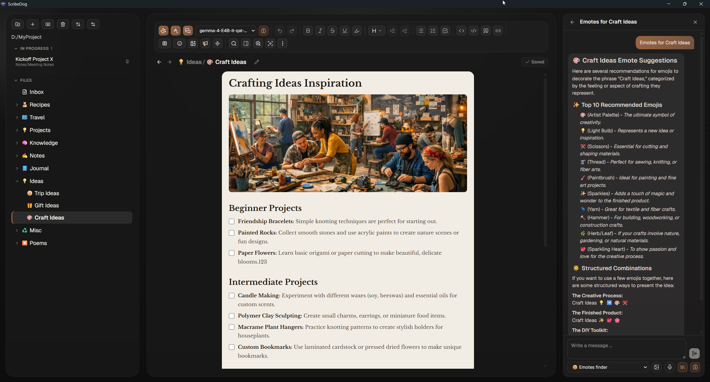
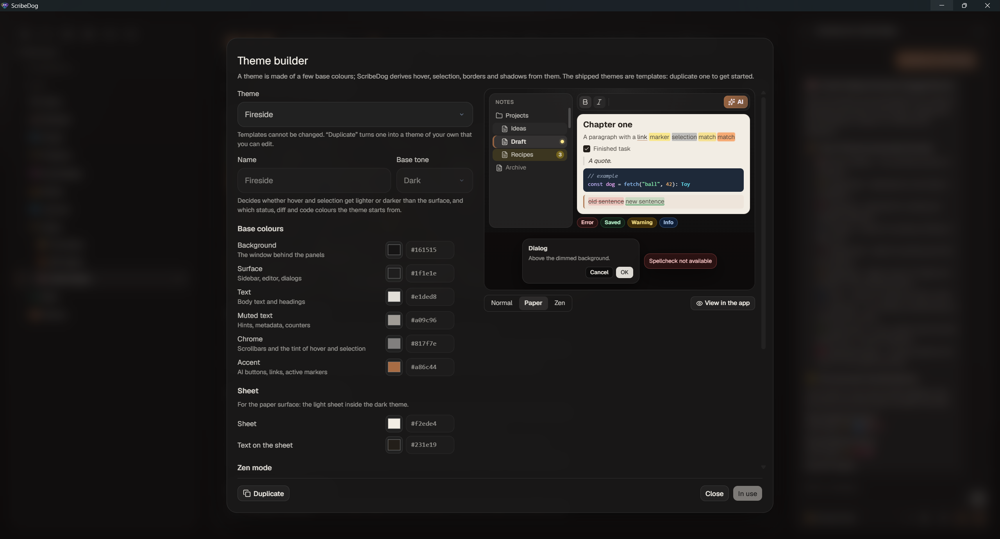

# Customizing

[Documentation](README.md) / Customizing

## Themes

ScribeDog ships with light and dark themes and four more:

| Theme | For |
|---|---|
| Light, Dark | The everyday pair |
| Sepia | Warm tones for long writing sessions |
| Fjord | A cool dark theme |
| Fireside | A warm dark theme |
| Midnight | True black for OLED screens |

There is also an optional **paper-white page inside the dark UI**. It helps
you judge long or layout-heavy documents.

## Your own themes

The **theme builder** lives under **Settings, Appearance**. It starts from
any built-in theme.

This is what a custom theme can look like: a warm amber accent and a
paper-coloured page.

You pick a handful of base colours:

- background
- surface
- text
- muted text
- chrome
- accent

Hover, selection, borders and shadows follow on their own. A live preview
shows every colour before you use the theme, including the paper sheet and
Zen mode. Zen mode can get a background and text colour of its own.

An **Advanced** section covers status, highlight, diff and code colours.

It also holds the mark of the open note: its name, its background and the
bar at its left edge. Background and bar have an opacity of their own, so a
mark can be toned down or removed entirely, and the name's colour can carry
the note instead. By default the file tree and the "In progress" list wear
the same mark, which is why the open note looks alike in both. Tick **Show
the "In progress" list differently from the file tree** and the list keeps
the colours it has at that moment, free to be set on its own from then on.
The preview then shows the list above the notes, so you see the same note
marked both ways at once.

Themes can be exported and imported as a small JSON file, or through the
clipboard.

## Tables

A Markdown table always has a header row, so the first row of every table is
shown bold on a grey fill. If you want a table whose first row looks like all
the others, switch on **First table row without header look** under
**Settings, Appearance**.

The setting only changes how the table is shown. It applies to every table, in
the editor and in all exports and in print, and it leaves the file as it is.
Other apps that open your note still show that row as the header.

## Fonts

**Settings, Fonts** sets the font and the text size of your notes. Both apply
to the editor and to every export (PDF, Word, ODT, HTML, EPUB) and to print.
Eight fonts come with ScribeDog, each shown in its own letterforms.

### Your own fonts

Press **Import font** and pick one or more `.ttf` or `.woff` files. The font
shows up as another card, and you can select it like any other. A card has a
trash icon when you hover over it, which removes the font again (after a
confirmation). Remove the font you are using and ScribeDog goes back to the
system font.

You can pick all the files of a download at once. ScribeDog sorts them by
family and uses the regular, bold, italic and bold italic file of each. A font
that comes without bold or italic uses its regular file for those in the PDF,
so bold and italic text looks plain there.

| File | Works |
|---|---|
| TrueType (`.ttf`) | yes |
| WOFF (`.woff`) | yes |
| WOFF2, variable fonts, font collections (`.ttc`) | no, ScribeDog tells you why |
| OpenType with PostScript outlines | no, use the TTF version of the font |

A PDF can only show a font whose file is embedded, which is why the fonts that
cannot be embedded are refused when you import them, instead of looking fine
in the editor and changing in the PDF. In the PDF, only the characters you
used are embedded, so a large font does not make the file large.

The fonts are stored in the opened folder, in `.scribedog/fonts/`, one
subfolder per font. They belong to the folder: open another folder and its
fonts are the ones on offer. Which font you chose is a setting of the app, so
it comes back when the folder with the font is open again. Import needs an
open folder for that reason, and it works the same in the
[server edition](../server/docs/README.md).

### Icon fonts

Fonts with icons (Nerd Fonts, for example) are marked **Icons** on their card.
Once one is imported, the emoji button in the toolbar gets a second tab,
**Icons**. It lists every icon of the font, read from the font file itself, so
nothing has to be set up. Type part of a name to search ("docker" finds
`linux-docker` and `dev-docker`), narrow it to one icon set with the chips
under the search field (`fa`, `md`, `dev` ...), or look at the row of
recently used icons. Hover an icon to see its name and its code. With several
icon fonts imported, a menu at the top switches between them.

The picker opens on the tab you used last, so working with icons does not mean
switching tabs every time. `Ctrl+Shift+M` opens it at the cursor, and in the
file tree it opens the picker for the icon of the selected file or folder (you
can change the shortcut under **Settings, Shortcuts**). The toolbar button
shows the shortcut in its tooltip.

The picker works with the keyboard. In the search field, `Tab` (or the down
arrow) goes straight to the icons, the arrow keys move between them (`Home`,
`End`, `Page up` and `Page down` jump further), and `Enter` inserts the icon.
The up arrow in the first row goes back to the search. The icon-set chips come
last in the `Tab` order, and the left and right arrows move between them.

An icon you insert is an ordinary character in the note. You do not have to
set the note in the icon font: the editor, print and PDF take the icons from
the imported font and everything else from the font you chose. If you set the
whole note in a Nerd Font, pick its *Propo* variant for running text; the
other variants draw icons wider than a letter, so they overlap their
neighbours.

The same **Icons** tab is in the picker for the icon of a file or folder (right
click it in the file tree, or click the icon in the breadcrumbs). The icon is
then shown in the tree and the breadcrumbs. If you remove the font again,
those places show the empty placeholder box a missing character gets, as text
does; pick another icon to replace it.

Word, ODT, EPUB and HTML only name the font, so a reader needs it installed to
see the icons there. In a Markdown file opened elsewhere, the icon is a
character without a picture unless the font is installed. Hovering an icon in
the picker shows its name, so you can tell what was meant.

Check the licence of a font before you share a folder that contains it. The
files are copied as they are.

## Languages

The interface comes in 10 languages: English, German, Spanish, French,
Italian, Portuguese, Russian, Ukrainian, Japanese and Chinese.

## Keyboard shortcuts

Press `Ctrl+#` for the cheat sheet. **Every shortcut in it can be remapped**:

1. Click a key combination.
2. Press the one you want.
3. It is saved right away.

Conflicts are caught before they are assigned. A binding has to include
`Ctrl` or `Alt`, because `Shift` alone would swallow ordinary typing.

Your overrides are stored in a `shortcuts.json` file in the app config
folder. They are app-wide, not per vault. In the portable build the file lives
in the `.scribedog` folder next to the executable.

## Settings

Settings are grouped by what they belong to: **Application**, **AI** and
**Folder**. The entries that live in the open folder say so at the top.

Every setting has a one-line hint. A longer explanation sits behind the (i)
next to its label.

## Toolbar and window

- A one-click formatting toolbar with active-state highlighting. Extra
  options, such as spell check, auto-save and page lines, sit in its options
  menu.
- Window size and maximized state are remembered across restarts.

## Hiding the AI features

If you never want AI, switch off **Show AI features** in the application
settings. The AI buttons, the chat and the AI settings pages disappear.

[Back to the documentation index](README.md)
