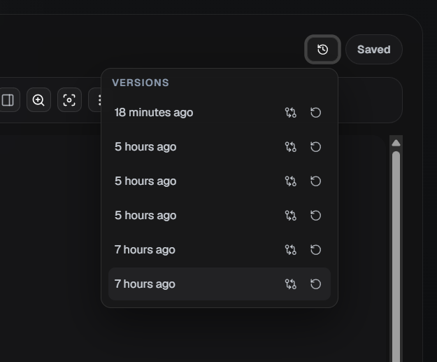
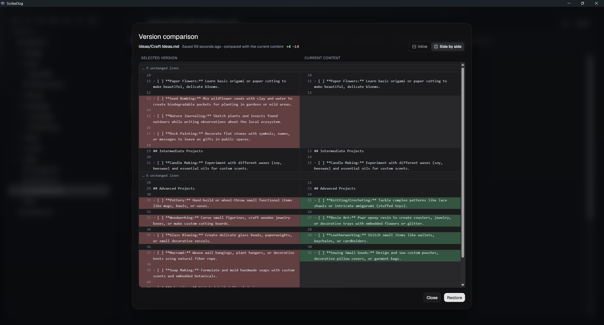
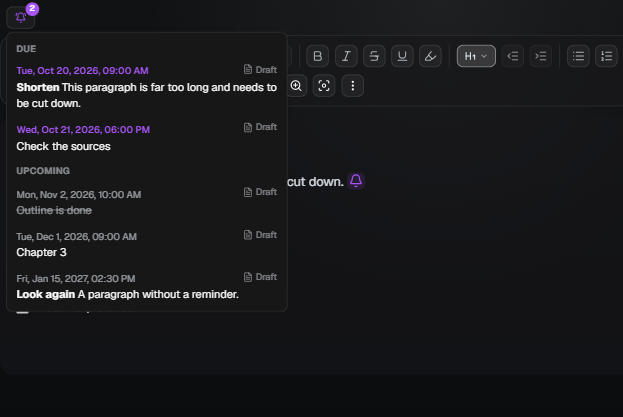

# Notes and your vault

[Documentation](README.md) / Notes and your vault

A vault is just a folder. Open any folder and ScribeDog finds every `.md`
file inside it and shows the files as a tree in the sidebar. There is no
database and no import step.

## The file tree

- Create, rename and delete files and folders from the sidebar.
- **Sorting.** Order by name or last modified, or switch to manual mode and
  drag files and folders into your own order.
- **Live sync.** A native file watcher picks up changes made outside the app
  automatically.
- The note title is shown as a **breadcrumb**. With folder notes on, each
  crumb opens that folder note.

Sidebar preferences such as sort mode and manual order are remembered per
folder, in a small hidden `.scribedog` directory inside the vault.

## Folder notes

Off by default. Switch them on per folder under **Settings, Open folder**.

With folder notes, every folder gets a text of its own, the way a node in
Trilium or Notion is both a folder and a page. Click the folder name to open
its note. The arrow expands the folder.

- The note is a plain `.scribedog-foldernote.md` inside the folder, created
  on the first save.
- It moves, renames and deletes together with the folder, even if you do that
  in Explorer or Finder.
- Search, versions, export (as the introduction chapter of the folder) and the
  AI chat treat it like any other note.
- Switching the feature off only hides it. The files stay.

## Linked notes

Connect notes to each other with plain links.

- **Drag a file from the sidebar into the note.** It becomes a link labelled
  with the file name. A multi-selection inserts them all.
- **Insert link** (`Ctrl+L`) takes a URL or one of the vault files, picked
  from a search list with autocomplete.
- **Type `[[`** anywhere for a wiki-style picker at the cursor. Keep typing
  to filter, use the arrow keys to choose and `Enter` to insert.
- **A click follows a link.** A note link opens that note. Any other link
  opens in your system browser.

Links are stored as plain relative Markdown links, for example
`[Note](sub/note.md)`. A linked vault stays readable and portable in every
other Markdown tool.

### Back and forward

The buttons next to the file name, or `Alt+Left` and `Alt+Right`, retrace
the notes you opened. Following a chain of links and coming back is one
keystroke. Deleted files are skipped.

## Details panel

Open it from the toolbar or with `Ctrl+Shift+D`. It is resizable and shows:

- a live **outline** of the headings. Click one, or use the arrow keys, to
  jump to that section.
- what this note **links to**, and which notes **link back** to it. Targets
  that no longer exist are marked.
- **File info**: word count, estimated reading time, and when the note was
  first and last edited.

## Pinned notes: "In progress"

A list above the file tree for the notes you are working on. It stays out of
the way until you pin a note.

- **Pin a note** with the pin icon that shows when you hover a row, with
  `Shift+Enter`, from the context menu, or by double-clicking it.
- **Close an entry** by taking its pin away, with `Ctrl+W`, a middle click or
  `Delete`. A note with unsaved changes asks Save, Discard or Cancel first.
- Browsing the tree never adds anything. A setting lets edited notes join
  automatically if you prefer.
- Another setting makes a click only select a note, and a double-click open
  it. That is handy in a presentation.
- Saving leaves the entry in place. **Close saved** in the header tidies up.
- The list is remembered per folder in `.scribedog/open-files.json`. A setting
  turns that off.

Unsaved notes are marked in the tree: a yellow dot on the note, and a ring on
a collapsed folder that has one inside.

## Saving

### Auto-save

Off by default. Switch it on in the toolbar options. It saves after a short
pause in typing and when you leave a note.

### Saving never overwrites an outside edit unnoticed

A note can change on disk while you edit it: another editor, a sync client,
a second device. ScribeDog writes only while the note is still the version
it read. If it is not, the two versions are merged line by line.

| Your edits and the other ones | What happens |
| --- | --- |
| at different places | merged and saved without asking; the editor shows the result and your cursor stays put |
| at the same lines | you are asked |

When you are asked, **Review passages** shows each overlapping passage in the
editor, the other version in red and yours in green, and you accept or
discard them one by one (or all at once from the bar above the note). Saving
waits until every passage is decided. **Keep my version** overwrites the
other one instead.

> **Nothing is lost while versioning is on.** Your whole version goes into the
> version history before a review starts, and the other one goes there before
> you overwrite it.

Auto-save never opens the question while you type. It pauses for that note,
and the save button says **Resolve conflict** until you click it.

### Unsaved changes survive a restart

A note you edited but did not save is kept as a draft in the vault folder
`.scribedog/drafts/`. The draft is written a few seconds after you stop
typing, and whenever the window loses focus or closes.

Reopen the folder and the note is back as you left it, still marked as
changed. This is not auto-save: the note itself is only written when you
save, and the draft is deleted the moment you do.

> **Using Git?** That folder is written while you type. Add `.scribedog/` to
> your `.gitignore` unless you want it tracked.

### Safe switching

Leaving an unsaved file, or an undecided AI suggestion, asks you to save,
discard or cancel. A clear dot shows unsaved state.

## Version history

Switch it on under **Settings, Versioning**. From then on, every save first
snapshots the previous content. Saves that change nothing do not create a
duplicate.

Open the popover from the note header to see every snapshot with its time.

- **Compare** any snapshot with the current file, line by line, inline or
  side by side.

  

- **Restore** a version with one click. The current content is snapshotted
  first, so a restore is itself just another undoable step.
- Choose how many versions are kept per file, from 1 to 200 (default 10), and
  clear all stored versions at once for a fresh start.

Versions live locally next to your files, in the same hidden `.scribedog`
folder. Nothing leaves your machine.

## Reminders

Any paragraph, heading or list item can carry a reminder: a checklist item
you want to be reminded of, or a paragraph you still have to rework. Put the
cursor in it (no need to select anything) and click the bell in the editor
toolbar, or press `Ctrl+Alt+R`. Pick a date and a time, and add a short note
if you like. Without a note, the reminder is simply the paragraph's text.

A small bell at the end of the line marks the reminder. Once the reminder is
due, it turns to the accent colour and rings briefly every two seconds (not
when your system is set to reduce motion). Click it to open the same dialog again:
change the time, snooze a due reminder (by an hour, or to its own time
tomorrow), or remove it. **Remove** is the only way to take a
reminder off without deleting its text, and `Ctrl+Z` brings it back.

### Where you find them

The bell in the sidebar's header lists every reminder in the vault, due ones
first and each with the note it is in, and shows how many are due. It rings
along while something is due. Pick one to open its note with the
paragraph selected. On a phone or tablet, where the sidebar is hidden, a
pulsing dot on the sidebar button says that something is due.

While ScribeDog is running, a due reminder also shows up as a notification of
your operating system (in the browser edition, as a browser notification once
you allow it). Reminders that came due while the app was closed are announced
once, when you open the vault.

### What happens when you edit the text

| You... | The reminder... |
|---|---|
| edit the paragraph | stays |
| delete the paragraph | goes with it (undo brings both back) |
| press Enter inside the paragraph | stays on the first part |
| press Enter at the very start | stays with the text, the new empty line has none |
| join it with the paragraph above | moves up, unless that one has its own: then the upper one wins and a notice offers to undo |
| copy whole paragraphs | is copied too |
| tick or untick a checkbox | stays (ticked items are shown crossed out in the list) |

> **It is part of the note.** A reminder is stored at the end of its line as
> an HTML comment, for example
> `<!-- reminder: 2026-10-25 09:00 "Rework" -->`. Other Markdown tools show
> the text without it, exports and prints leave it out, and it travels with
> the paragraph when you move or rename the note, sync the folder or restore
> a version. The time is your local time.

Reminders cannot go into table cells or code blocks.

[Back to the documentation index](README.md)
### Let the chat set them

You can also ask the [AI chat](ai-chat.md#reminders): "remind me on Friday
to rework this paragraph" or "what is due this week?". It sets, moves and
removes reminders on the right paragraph and lists what is coming up.

