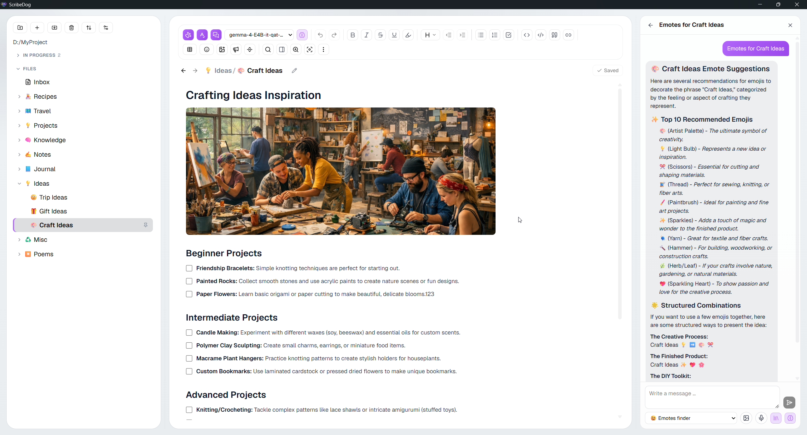
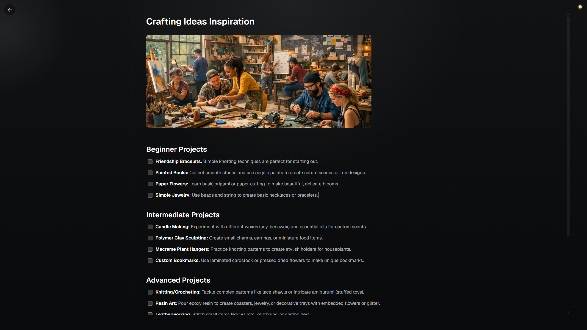

# Writing

[Documentation](README.md) / Writing

ScribeDog is a WYSIWYG Markdown editor. You write and format like in a word
processor, and the file on disk stays clean Markdown that any other tool can
open.



The editor is built on [TipTap](https://tiptap.dev/) and ProseMirror.

## What you can format

- Headings, bold, italic, underline, strikethrough
- Blockquotes, inline code and links
- Ordered, bulleted and task lists
- **Tables**, with a visual grid picker and a context menu for rows and
  columns
- **Images**, shown inline. Resize by dragging, and the width is saved back
  into the Markdown. Drag an image to move it; on a touch screen, hold it
  for a moment first.
- **Drawings**, sketched by hand right in the note or on top of an image (see
  [Drawings](#drawings))
- **Expandable sections** that fold content away under a title (see
  [Expandable sections](#expandable-sections))
- **Code blocks**, with a one-click copy button and syntax colouring for
  about 30 languages (PowerShell, Bash, INI/TOML, Dockerfile, Nginx, C, C++,
  Kotlin and more). The badge on the block's edge switches the language. A
  block without a language is recognised automatically and the badge says so
  ("PowerShell (auto)"); the Markdown file stays unchanged until you pick the
  language yourself. Inside a list the block stays part of its list item, so
  a numbered step can carry its own code.
- An **emoji picker** with search, including keywords in your language. Open
  it from the toolbar or with `Ctrl+Shift+M`, where it appears at the
  cursor (with the file tree focused, it sets the icon of the selected entry). It remembers whether you were on the Emoji or the
  [Icons](customizing.md#icon-fonts) tab
- **Reminders** on any paragraph, heading or list item, set with the bell in
  the toolbar or `Ctrl+Alt+R` (see
  [Reminders](notes-and-vault.md#reminders))

Undo and redo work from the toolbar and with `Ctrl+Z` and `Ctrl+Y`.

## Drawings

The pencil button next to "Insert image" opens a drawing surface. Sketch with
the mouse, a finger or a pen; a pen's pressure makes the line thinner or
thicker. Pick one of four line widths and one of the nine palette colours
(black, grey, red, orange, yellow, green, blue, purple and white), or choose
your own. The dialog starts with ink that suits your theme: light in the dark
theme, dark in the light one.

1. Click the pencil button in the toolbar, next to "Insert image".
2. Draw. Switch to the eraser to remove lines, and use undo if you slip.
3. Click **Insert**. The sketch appears at the cursor.

| Tool | What it does |
| --- | --- |
| Pen | Draws a line. Every line is its own object. |
| Eraser | Removes a line you touch, as a whole. |
| Undo / Redo | Steps back and forth one line (or one eraser stroke) at a time, also with `Ctrl+Z` and `Ctrl+Y`. |
| Clear all | Empties the surface. Undo brings it back. |

**Insert** saves the drawing as an SVG file in the `images/` folder and puts it
at the cursor like any other image. The image is cropped to what you drew and
has a transparent background, so it sits on light and dark pages alike. The
note itself stays plain Markdown: ``.

To change a drawing later, **double-click** it (or select it and tap the pencil
in its corner). The surface opens with all your lines, and **Apply** writes the
changes back into the same file.

> [!NOTE]
> Applying replaces the image file. The editor's undo cannot bring the old
> drawing back, only the dialog's own undo can, before you apply. **Cancel**
> throws away everything you changed in the dialog.

Only drawings made in ScribeDog can be edited this way. Other SVG files stay
ordinary images, since the drawing surface would lose whatever it cannot
represent.

### Drawing on an image

You can also draw on top of a picture in your note, for example to circle
something on a screenshot or mark up a photo. Right-click the image and choose
**Draw on image**. On a touch screen, tap the image and then the pencil in its
corner. The surface opens with the image as its background and red ink, which
shows up on most pictures.

**Apply** saves a new SVG next to the original in `images/` and points the image
in your note at it. The size, the alt text and the place in the note stay the
same. Your lines stay separate objects, so a double-click opens them again
later, exactly like a drawing of your own. Erasing every line and applying
leaves just the picture.

| | |
| --- | --- |
| Formats | PNG, JPEG, WebP, GIF and BMP. SVG files cannot be drawn on. |
| The original | Is stored inside the drawing, so the drawing is one file that shows the same everywhere: in other Markdown viewers, on GitHub and in every export. |
| Large photos | Keep their size in the note. Only the copy inside the drawing is scaled down to 2560 pixels on the longest side, which keeps the file small enough to open quickly. Smaller images are stored exactly as they are. |
| Lines past the edge | Are cut off at the edge of the picture. |

> [!TIP]
> The editor's undo turns the drawing back into the original image, as long as
> the note has not been saved since. After saving, the original file is cleaned
> up like any image the note no longer uses. Its content is still inside the
> drawing.

## Expandable sections

An expandable section hides its content under a one-line title until you open
it. Good for FAQs, long log output, solutions or anything a reader should only
see on request.

Insert one with the **Expandable section** button in the toolbar or with
`Ctrl+Shift+Enter` (you can change the combination in the shortcut settings). With text
selected, the selected blocks move into the new section. Type the title, press
`Enter` to continue in the content. The arrow to the left of the title opens
and closes the section.

Sections work in lists too. Select some list items and they move into a
section at their place in the list; a numbered list keeps counting after it.
Without a selection, the cursor in a list item adds an empty section below
that item, indented with it.

| Action | How |
| --- | --- |
| Insert a section | `Ctrl+Shift+Enter`, or toolbar button > Insert expandable section |
| Open or close it | Click the arrow next to the title |
| Leave the section | `Enter` on an empty last line |
| Remove the section, keep the content | Toolbar button > Remove expandable section, or `Backspace` in an empty title |
| Show it open to readers | Toolbar button > Expanded when opened |

Opening and closing a section in the editor does not change the note. What a
reader sees first is a separate setting, **Expanded when opened**, and only
that one is saved. Search, the outline and the arrow keys open a closed
section by themselves when they lead into it.

### How it is saved

The section is plain HTML that Markdown allows anywhere:

```markdown
<details>
<summary>How do I install it?</summary>

Download the **installer** and run it.

</details>
```

GitHub, GitLab, VS Code, Obsidian and every browser show this as a section
that opens and closes. The blank lines after the title and before
`</details>` make sure the content is read as Markdown there too. The title is
plain text, since tools disagree on formatting inside it.

> [!NOTE]
> Editors that do not show HTML display the two tags as text. The content
> stays complete and readable.

Sections written by other tools open in ScribeDog as well, also without the
blank lines or with the title on the `<details>` line. A section ScribeDog
cannot read safely, for example one with other attributes or with formatting
in the title, stays visible as text, like any other HTML in a note.

When you export, the HTML file keeps the sections collapsible. PDF, DOCX, ODT,
EPUB and the print show them open, with the title in bold.

## Highlighting

Mark a passage with the highlighter using the toolbar button or
`Ctrl+Shift+H`. In the file it is stored as `==text==`, so other Markdown
tools can show it too. Highlights survive every export.

With nothing selected, the shortcut switches on **marker mode**: everything
you select is highlighted until you press `Esc`.

## Move lines around

`Alt+Shift+Up` and `Alt+Shift+Down` move the current line or list item up or
down.

## Copy and paste

| Action | Shortcut |
|---|---|
| Copy with formatting | `Ctrl+C` |
| Copy as Markdown source | `Ctrl+Alt+C` |
| Copy as plain text | `Ctrl+Shift+C` |
| Paste (Markdown is rendered right away) | `Ctrl+V` |
| Paste the raw text as it is | `Ctrl+Shift+V` |
| Paste as Markdown, always | `Ctrl+Alt+V` |

Pasted Markdown, with headings, lists, tables or bold text, is turned into
formatted content at once. Use the raw paste when you want the syntax.

`Ctrl+V` only converts plain text that clearly looks like Markdown. Text copied
out of a web page or a chat answer usually brings its own formatting along, and
that formatting wins: a Markdown sample selected inside a code block lands as a
code block. `Ctrl+Alt+V` takes the plain text of the clipboard and always
renders it as Markdown, whatever else was copied with it. It also works when
the automatic conversion is switched off in the settings.

## Spell check

Optional red-underline spell check as you type, using the spell checker of
your operating system. Switch it in the toolbar options. On Linux it uses the
Hunspell or enchant dictionaries you have installed.

For AI spelling and grammar help, see [AI writing](ai-writing.md).

## Automatic heading numbering

Off by default. Switch it on per folder under **Settings, Open folder**. The
choice is stored in that folder `.scribedog` directory.

Headings then get `1.`, `1.1.`, `1.1.1.` in the editor, the outline, and in
every export and print.

- The numbers come from the structure and are **never written into the
  file**. Reordering sections needs no renumbering.
- Choose whether numbering starts at heading 1 or 2, how deep it goes, and
  whether numbers show everywhere or only in the outline. The outline only
  option suits a long note whose text and exports should stay clean.

Two markers follow the Pandoc convention:

| Marker at the end of a heading | Effect |
|---|---|
| `{-}` or `{.unnumbered}` | The heading and everything below it stays unnumbered |
| `{.unlisted}` | The heading stays in the text but is kept out of the outline |
| `{.unnumbered .unlisted}` | Both |

The marker is shown only in the heading you are editing, or always, as you
prefer.

## Block numbers

Handy when you talk about a note with someone else: "look at block 12" finds
the spot no matter how wide their window is.

Switch it on under **Settings, Appearance, Show block/line numbers**. A
narrow strip appears at the left edge of the page with one bar per block. The
block with the cursor is drawn in the accent colour with its number. Hover
any bar to see its number, click it to jump there.

ScribeDog counts **blocks**, not screen lines. A block is a paragraph, a
heading, a list item, a code block, an image, a rule or a whole table. Lines
on screen change with the window width, blocks do not.

| Option | What it does |
|---|---|
| Numbers on all blocks | Every bar shows its number, not only the active one |
| Highlight active block | Tints the block with the cursor. Code blocks, tables and images get a frame instead |
| Cursor position at the number | Off, for 2 seconds after moving, or always |

The cursor position widens the number badge: `7 | 27` is character 27 of
block 7. A selection shows its range, `7 | 41–65`, or where it ends in
another block, `7 | 27 → 8:4`. An image inside the text counts as one
character.

> [!NOTE]
> The gutter is off by default and hidden in Zen mode. The numbers are never
> written into the file.

## Placemarks

A placemark is a bookmark on one block of a note: the spot where you stopped,
a paragraph you still want to rework, a list you need to check again. Add a
comment, and next week you still know why you put it there.

| Action | How |
|---|---|
| Set or remove a placemark | `Ctrl+Shift+B` in the block, or right-click its bar in the [block gutter](#block-numbers) |
| Jump to the next one | `Alt+Page Down` |
| Jump to the previous one | `Alt+Page Up` |
| See all of them, add a comment | The **Placemarks** section of the [details panel](notes-and-vault.md#details-panel) |

Jumping wraps around at the end of the note. You can change all three
shortcuts under **Settings, Keyboard shortcuts**.

With the block gutter on, a marked block's bar turns amber. Without it, a
short amber stroke appears in the left margin next to the block.

In the details panel, click a placemark to jump there. The speech bubble opens
its comment: `Enter` saves, `Shift+Enter` starts a new line, `Escape`
discards the change. The `×` removes the placemark.

### Where they are stored

Placemarks are not written into your note. They live in
`.scribedog/placemarks.json` inside your vault, so the Markdown stays clean
and they travel with the folder to another computer. Rename or move a note
and its placemarks go along. Delete it and they are gone.

A placemark remembers its block by the first words of its text. If you edit
the note in another program and a few paragraphs move, the placemark still
finds its block. If the text is gone, it stays at about the same position.

> [!NOTE]
> Placemarks are personal. In a vault that several people share on a
> ScribeDog server, everyone has their own, and nobody else sees yours.

## Zen mode

Press `Ctrl+Shift+Y`, or use the toolbar button, to strip away the sidebar,
toolbar and header. You get a full screen with just your text in a
comfortable column.



- **Resize the column.** Drag its edges, or use the arrow keys once the edge
  has focus. The width is remembered.
- **Zoom the text.** `Ctrl` with the mouse wheel, or a pinch on a touch
  screen. The zoom is remembered separately from the document font size, so
  Zen mode can be larger without touching the normal view.
- A small dot in the top right corner shows unsaved changes. One button in
  the top left returns to the normal view.

The Zen page can have its own background and text colour in the
[theme builder](customizing.md#your-own-themes).

## Files stay portable

Notes are saved as clean, diff-friendly Markdown. Open the folder in any
other editor, put it under Git, or sync it. Nothing ties you to ScribeDog.

[Back to the documentation index](README.md)
